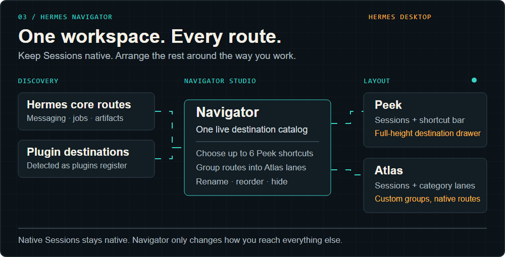

# Hermes Navigator

[](assets/hero.svg)

Hermes Navigator is an additive navigation workspace for Hermes Desktop. It keeps the native Sessions and Projects browser intact, auto-discovers route-backed core and plugin destinations, and presents them through two configurable layouts.

## What it adds

- **Peek:** native Sessions fills the pane; a compact bar exposes up to six chosen destinations and a full-height destination drawer.
- **Atlas:** destinations are grouped into customizable category lanes beside the native Sessions lane.
- **Navigator Studio:** switch layouts, choose Peek shortcuts, rename/reorder/hide destinations, and create, rename, reorder, hide, or remove Atlas categories.
- **Command palette:** open Navigator, Navigator Studio, or any detected destination through `Ctrl+K`.
- **Automatic discovery:** core pages and registered `sidebarNav` plugin contributions appear without a second hard-coded navigation list.

Preferences are stored through Hermes plugin storage. Navigator makes no network requests and does not replace Hermes's session, project, profile, route, or plugin ownership logic.

## Current host boundary

This first source release targets Hermes Agent commit [`2bd378ed1b8d6bf2192cb26e0a55ff3091e6bd19`](https://github.com/NousResearch/hermes-agent/commit/2bd378ed1b8d6bf2192cb26e0a55ff3091e6bd19). It includes a small host overlay that exposes:

- the raw route-backed sidebar destination catalog;
- the native Sessions/Projects browser as a reusable SDK surface;
- the native profile rail used by Atlas.

The overlay is version-pinned and deliberately refuses an unreviewed host revision. Once those SDK seams are available upstream, Navigator can return to an ordinary `desktop/plugin.js` install.

## Build and verify

```sh
npm ci
npm run build
npm run test
npm run build:check
```

Install into the pinned Hermes source checkout:

```sh
node scripts/install-host.mjs C:/Users/<you>/HermesHome/hermes-agent
cd C:/Users/<you>/HermesHome/hermes-agent/apps/desktop
npm run typecheck
npm run build
```

See [installation](docs/installation.md), [architecture](docs/architecture.md), and [limitations](docs/limitations.md).

## Repository layout

```text
desktop/src/       Navigator plugin source
desktop/plugin.js  generated runtime bundle
host-overlay/      version-pinned Hermes SDK/native-session seam
scripts/           deterministic build and guarded host installer
docs/              architecture, installation, and limitations
```

## License

MIT. This repository is owned and maintained by [`noxius-studium`](https://github.com/noxius-studium) and published by [@Deadtrix21](https://github.com/Deadtrix21).
